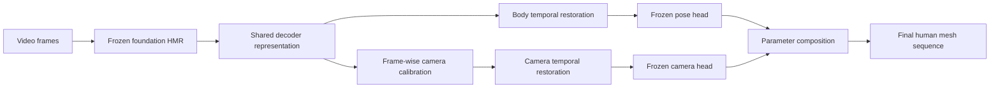

# DualRest-HMR

**Dual-Space Spatio-Temporal Restoration for Human Mesh Recovery**

## Project overview

DualRest-HMR restores occlusion-degraded predictions from a frozen foundation
human mesh recovery model in two complementary spaces:

- **Body representation restoration** uses bidirectional temporal context to
  restore the shared 1024-dimensional decoder representation before the frozen
  pose head.
- **Progressive camera restoration** first calibrates camera-related features
  frame by frame and then restores their temporal consistency before the frozen
  camera head.

The restored body and camera predictions are composed with the remaining frozen
foundation predictions to produce the final human mesh. The repository includes
the three restoration checkpoints used by the validated inference path. It does
not include foundation-model checkpoints or datasets.

## Method overview



The restoration adapters are the only learned DualRest-HMR components in this
inference path; the foundation HMR model and its prediction heads remain frozen.

## Repository structure

```text
DualRest-HMR/
├── adapters/                     # MHR/SMPL conversion adapters
├── assets/                       # Project assets and resource notes
├── checkpoints/dualrest/         # Released restoration checkpoints
├── configs/body4d.yaml            # External foundation-resource configuration
├── evaluation/                    # Evaluation utilities and protocols
├── models/                        # Foundation and DualRest-HMR model code
├── scripts/
│   ├── validate_dualrest_minimal.py
│   ├── train_dynamesh_v2_phase2.py
│   ├── train_dynamesh_v2_camera_phase2.py
│   └── evaluate_dynamesh_v2_full_integration.py
├── tests/                         # Research and protocol tests
├── requirements-inference.txt     # Validated inference dependencies
└── README.md
```

## Environment setup

The independent 16-frame validation was completed with:

- Python 3.12.13
- PyTorch 2.8.0 and torchvision 0.23.0
- CUDA 12.8 on an NVIDIA RTX 4090
- `mamba-ssm` 2.3.2.post1 and `causal-conv1d` 1.7.0

Create an environment and install a CUDA-compatible PyTorch build first. The
following commands reproduce the versions used for validation; adapt the
PyTorch index URL if your CUDA runtime differs.

```bash
conda create -n dualrest python=3.12 -y
conda activate dualrest

pip install torch==2.8.0 torchvision==0.23.0 \
  --index-url https://download.pytorch.org/whl/cu128
pip install -r requirements-inference.txt
```

`mamba-ssm` and `causal-conv1d` contain compiled CUDA components and must match
the installed PyTorch/CUDA combination. The dependency file records the exact
versions observed in the validated environment; it is not a substitute for
selecting a compatible PyTorch build for another machine.

`requirements-inference.txt` is scoped to the validated minimal inference path.
The existing `pyproject.toml` preserves the broader upstream SAM-Body4D
application metadata and optional dependencies.

## Pretrained models

### DualRest-HMR restoration checkpoints

These checkpoints are included in the repository and loaded by
`scripts/validate_dualrest_minimal.py` from fixed repository-relative paths.

| Component | Repository path | SHA-256 |
|---|---|---|
| Body restoration | `checkpoints/dualrest/body/best.pt` | `f1509cc1a8bfae84501aeac2004529b029fb8a4b60afa8a4349faf31efe60329` |
| Camera frame-wise restoration | `checkpoints/dualrest/camera/framewise/best.pt` | `fd318ddbe3e3a1e9a13134e649ce92aa60c9b28385bf809ffb3ffc44ef516cb2` |
| Camera temporal restoration | `checkpoints/dualrest/camera/temporal/best.pt` | `e7562abc45825de76ddb7a24b60bdf3675061c9ba63ac150071558b98f6ac865` |

The validation script checks these hashes before loading the adapters.

### Foundation checkpoints

Foundation weights are not distributed in this repository. For the minimal
validation path, prepare the released SAM-3D-Body resources in this layout:

```text
FOUNDATION_CHECKPOINT_ROOT/
└── sam-3d-body-dinov3/
    ├── model.ckpt
    └── assets/
        └── mhr_model.pt
```

The full SAM-Body4D application additionally references SAM 3, MoGe-2,
Diffusion-VAS, a detector/segmentor checkpoint, and Depth Anything V2. Their
configurable locations are documented in `configs/body4d.yaml`. Obtain every
external model from its official source and comply with its license and access
terms.

## Quick start

The minimal validator runs the complete frozen-foundation, body-restoration,
frame-wise-camera, temporal-camera, and parameter-composition path on a real
3DPW sequence. It expects the standard 3DPW directory layout, including
`sequenceFiles/<split>/<sequence>.pkl` and `imageFiles/<sequence>/`.

From the repository root:

```bash
export DUALREST_CHECKPOINT_ROOT=/path/to/foundation/checkpoints

python scripts/validate_dualrest_minimal.py \
  --dataset-root /path/to/3DPW \
  --foundation-checkpoint-root "$DUALREST_CHECKPOINT_ROOT" \
  --output-dir /path/outside/repository/dualrest_validation \
  --sequence courtyard_basketball_01 \
  --person-id 0 \
  --split validation \
  --frames 16 \
  --batch-size 4 \
  --occlusion-ratio 0.0
```

Important details:

- `--output-dir` must not already exist and must be outside this repository.
- The minimal validator derives fixed person boxes from the selected 3DPW
  annotation; it does not run the full detector/tracker application.
- `--reference-cache` may optionally check foundation-token equivalence against
  an existing cache.
- `--protected-source-root` may optionally assert that no Python module was
  imported from another source checkout.

Successful execution writes:

```text
/path/outside/repository/dualrest_validation/
├── minimal_outputs.npz
└── validation_report.json
```

The JSON report records input frames, checkpoint hashes, environment details,
tensor summaries, finite-value checks, and imported-module provenance.

## Validation

The release candidate was validated on a real 16-frame segment from
`courtyard_basketball_01` (person 0, 3DPW validation split). The complete path
loaded all three released restoration checkpoints and produced finite outputs:

| Output | Shape |
|---|---:|
| Body token | `[16, 1024]` |
| Body vertices | `[16, 18439, 3]` |
| Frame-wise camera token | `[1, 16, 1024]` |
| Temporal camera token | `[1, 16, 1024]` |
| Camera parameters | `[16, 3]` |
| Final vertices | `[16, 18439, 3]` |

This is a minimal inference validation in the recorded server environment, not
a replacement for the full dataset evaluation reported in the paper.

## Training and evaluation

The repository preserves the research entry points used for the original
experiments:

- Body restoration training: `scripts/train_dynamesh_v2_phase2.py`
- Camera restoration training: `scripts/train_dynamesh_v2_camera_phase2.py`
- Full integration evaluation: `scripts/evaluate_dynamesh_v2_full_integration.py`
- 3DPW-OC protocol utilities: `evaluation/three_dpw_oc/`

The minimal inference path above is the portability-validated release path.
Some historical training and evaluation scripts still contain machine-specific
dataset/cache defaults from the research environment. Treat them as research
artifacts until their paths are supplied through the corresponding arguments or
configs; this release does not claim that every training script is immediately
portable across machines.

## Acknowledgements

DualRest-HMR builds on SAM-Body4D and its upstream components, including SAM 3,
SAM-3D-Body, DINOv3, MoGe, Diffusion-VAS, Detectron2, and related utilities.
Third-party source trees retain their original notices and license files.

## Citation

Citation information for DualRest-HMR will be added with the paper release.
If you use the foundation SAM-Body4D code, please also follow its upstream
citation requirements.

